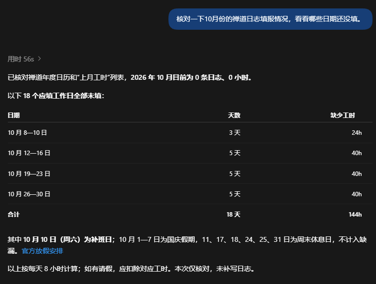

# Chandao Skill

用自然语言让 AI 在禅道里查版本、提交测试单、处理 Bug 或补录工时。日常操作直接通过 HTTP 完成，无需打开浏览器。

## 补写禅道日志

> 昨天下午花了 3 个小时查 App 请求被黑名单误拦的事，忘记填禅道了，帮我补一下。

记得做了什么，就可以从工作内容说起。AI 会在你负责的任务里查找，结合产品、任务名称和描述定位。能明确对应到一条时，它会核对当天已有日志，补写后告诉你记到了哪个任务、记了多久。

如果同时查到两个相似任务，补一句就能区分。

> **你**：昨天查黑名单花了俩小时，帮我记一下。
>
> **AI**：你手上有两项相关任务，一个是 App 请求误拦，一个是浏览器域名过滤。昨天查的是哪个？
>
> **你**：App 那个。

### 看看哪些天漏填了

> 核对一下 10 月份的禅道日志填报情况，看看哪些日期还没填。



图中把 10 月 10 日这个调休周六计入了应填工时。表格列出的是待核对的缺口，有请假时还要扣除相应工时。

## 项目提测怎么用

**查询示例**

> App 那个符号表升级是不是已经提测了？帮我看看提的是哪一版。

**提测示例**

> 符号表上传那块改好了，帮我提个测。这次让测试重点看看，以前传的文件还能不能重新解析。

项目不明确时，AI 会列出 **RUM-产品迭代-2026、RUM-客户支持-2026、观云-RUM-2025** 供选择，也接受手动输入项目名或 ID。它会在项目实际关联的产品中查找记录。创建测试单前，负责人、开始日期、结束日期缺哪项就问哪项。

测试单描述保留七个固定标题。**自测是否通过**和**提测功能是否演示**固定填写“是”。其余五段是提测范围、影响范围、配置变更、部署依赖、测试重点及风险，支持 Markdown 列表、加粗、行内代码和表格，在禅道中显示为富文本。完整模板和命令见[项目提测接口与示例](references/project-qa.md)。

## 能做什么

### 测试单与项目版本

- 按项目和产品列出测试单或版本，按 ID 查看详情。
- 创建缺少的版本，并把测试单关联到所选版本。编辑测试单时可只改截止日期、负责人或某段正文。
- 按 ID 编辑或删除后，客户端会回读禅道核对结果。删除需要当前账号对该记录有删除权限。

这里管理的是提测单及其关联版本。测试人员执行用例、录入结果属于独立流程。

### Bug 相关

- 查询我负责的 Bug 列表，以及 Bug 的标题、产品、状态、严重程度、优先级和复现信息
- 查看指定 Bug 的详细信息和处理历史
- 在明确授权后解决 Bug，提交当前禅道表单实际提供的解决方案、解决版本和备注
- 提交后重新读取 Bug，核对状态、解决方案和解决版本

### 工时日志相关

- 查询某段日期、某个月或某一年的工时记录
- 核对工时是否缺失、重复、日期错误或总时长不合理
- 按指定任务或 Bug、日期、耗时和工作内容补录工时
- 修改或删除确认错误的工时，并重新核对结果

### 其他支持

- 查询我负责的任务及任务详情
- 处理登录失效、验证码、二次认证或密码变更等异常，并给出明确提示

## 安装

```bash
npx skills add CHOSEN-ONE/skills --skill chandao
```

Windows PowerShell 如果提示脚本执行策略错误，请使用 `npx.cmd` 替代 `npx`。

## 使用前准备

准备一个有禅道权限的账号，并在运行 AI 的终端中配置环境变量：

Windows PowerShell：

```powershell
$env:TINGYUN_USERNAME = "你的禅道账号"
$env:TINGYUN_PASSWORD = "你的禅道密码"
```

macOS 或 Linux：

```bash
export TINGYUN_USERNAME="你的禅道账号"
export TINGYUN_PASSWORD="你的禅道密码"
```

不要把账号、密码、Cookie 或登录缓存提交到 Git 仓库。默认禅道地址为公司内部地址 `https://chandao.tingyun.com/pro/`；如果你的环境地址不同，需要在运行环境中配置对应地址。

## 日常还可以怎样问

| 想做的事 | 可以直接这样说 |
| --- | --- |
| 查任务进度 | 我手上那个优化请求黑名单的活儿，禅道上还剩多少工时？ |
| 找漏填的日志 | 帮我看看上周哪天工时没填够。周三下午我请了半天假。 |
| 整理几天的工作 | 我把这周每天干的事贴给你，你帮我对一下禅道，看看还要补哪几条。先列给我看。 |
| 改错工时 | 昨天排查数据推送那条我少记了一小时，帮我从 2 小时改成 3 小时。 |
| 查 Bug | 分给我的那个“上传完一直转圈”的问题，测试当时是怎么复现的？ |
| 解决 Bug | 刚才说的那个上传一直转圈的问题，我修好了，帮我在禅道里标成已解决。 |

## 写入规则

- 查询默认是只读操作，不会改变禅道数据
- 新增、修改、删除测试单、项目版本和工时，以及解决 Bug，均需明确授权
- 提测前核对项目、产品和关联版本；记录工时前核对任务或 Bug ID、日期、耗时和内容
- 会检查重复记录；写入后会重新读取服务端结果
- 单条工时大于 0 且不超过 4 小时，不填未来日期
- 周末、节假日、请假日和工时分配不确定时，会先提示并请求确认
- 登录失败、MFA、验证码或密码变更无法由 skill 自动绕过

## 常见问题

**提示没有账号或密码**

检查运行 AI 的终端是否设置了 `TINGYUN_USERNAME` 和 `TINGYUN_PASSWORD`，然后重新发起查询。

**提示需要验证码、MFA 或修改密码**

按禅道页面要求完成处理后，再让 AI 重试。skill 不会保存或输出密码，也不会自动修改密码。

**中文显示乱码**

Windows PowerShell 可设置 `$env:PYTHONUTF8 = "1"`；macOS 和 Linux 通常无需额外设置。

**为什么 AI 没有直接写入**

“看看昨天的日志”是查询；“把昨天符号表联调那条从 2 小时改成 3 小时”已经说清了要改什么。AI 会先找对应记录。如果同一天有两条相似日志，它会列出差别，让你选对再改。

## 隐私与安全

skill 使用 HTTP API 访问禅道，不依赖普通 Chrome 登录状态。Cookie 只保存在当前工作区的 `.chandao-session` 目录，不应分享或提交。公开仓库中不包含企业账号、密码、Cookie 或认证状态文件。

## 反馈

请提交 Issue，并附上脱敏后的请求、日期范围和错误信息。不要上传密码、Cookie、完整登录页面或内部接口响应。

## License

MIT
